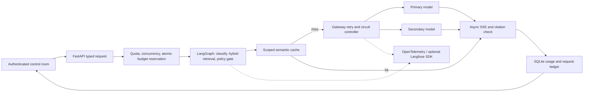

# Architecture and contracts

## Request and state schemas

`Investigation`: question (8-1500 characters), enumerated scenario, cache permission and baseline flag; extra fields forbidden. Server-derived identity is `local-operator`, never a caller-supplied user ID.

`Document`: validated ID, title, body, version, category and cache eligibility. `scripts/ingest.py` validates a whole replacement JSON corpus with unique IDs, size bounds and a small instruction/secret quarantine rule. Restart loads the new corpus. Its content fingerprint changes the cache namespace. This is structured JSON ingestion, not a general PDF ingestion pipeline.

Graph state: question, route (`policy` or `incident`), normalized embedding, ranked source records, cache eligibility and executed stage list. Retrieval scores use BM25 and cosine ranking fused by reciprocal ranks, constant 60. Source IDs/version and scores are exposed for inspection. Classification and control are deterministic; the model reasons over bounded evidence in the final response.

Request record: random request ID, time, status, profile, fault scenario, baseline flag, SHA-256 question hash, source metadata, attempt list (provider, number, outcome, duration/error), cache outcome, trace ID, latency, first-token latency, source-ID check, usage provenance and configured-rate cost. Raw question and answer content are not stored in the request ledger. A local cached answer necessarily contains response text and needs the same privacy controls as the corpus.

SSE event contract: `start`, `stage`, `sources`, `cache`, `routing`, `retry`, `token`, `error`, `done`. Each frame contains JSON `data`. Errors before admission use ordinary HTTP error codes. After streaming begins errors are SSE events and end in a persisted outcome. Comments provide five-second heartbeats. Client fetch streams do not automatically resume; no reconnect/replay guarantee is made.

Statuses: `success`, `needs_review`, `error`, `partial_error`, `cancelled`. Missing/invalid source citations produce `needs_review`, not a validated answer. Citation checks are structural, not entailment evaluation.

## Retry and cancellation ownership

In `live` and `simulated` modes Aegis owns one retry per provider, capped jitter, transient error classification, circuit state, and one overall deadline. Rate-limit Retry-After is bounded by policy; permanent request/authentication errors terminate. A primary failure before content can route to secondary. Once any content is emitted, failures terminate explicitly. Half-open probes are limited to one in-flight probe per circuit. Circuits are separated by provider and scenario so a lab failure does not poison the healthy scenario.

`proxy` mode sends one request to LiteLLM; the app does not add retry/fallback/circuit control. Proxy attempts are not individually visible in the app's attempt ledger; verify them using proxy telemetry. `scripts/day21_retry.py` is an isolated tenacity learning example and must not wrap the main proxy path.

The producer runs in one asyncio task with a 64-event queue, keeping OpenTelemetry context consistent across yields. Disconnect cancels the producer, closes the HTTP stream and records cancellation. Caller cancellation cannot refund tokens already generated upstream.

## Cache scope and admission

Scope hashes include operator identity, corpus fingerprint, retrieved source set, model group/profile, embedding model, prompt/policy version and deterministic generation settings. Only completed source-ID-checked responses from reviewed static FAQ routes can populate the cache. Fault scenarios, baseline requests, dynamic incidents, obvious personalized questions, negation, numerical constraints and URL/email-containing questions bypass response caching. This conservative heuristic is not a general privacy or semantic-safety guarantee.

Default threshold is cosine similarity > 0.94. Redis returns cosine distance, so compare `1 - distance`. Redis indexes and key prefixes separate vector dimensions; scope also separates embedding model identity. Entries expire after one hour. The SQLite profile performs brute-force cosine comparisons over a bounded local cache; the Redis profile performs actual FT.SEARCH vector queries.

Ingress request rate and concurrency limits are process-local, matching the documented single-worker deployment. Budget reservations are SQLite transactions and survive restarts. There is one cumulative operator budget; user/team hierarchies and distributed rate limiting are not implemented. Do not add workers without moving rate/circuit/concurrency controls to shared state.

API-cost reservations use bounded request/context size, output tokens and the maximum attempt count at operator-configured rates. Final reported usage is reconciled. Unknown failed-attempt usage retains the reservation for operator review; there is no automatic expiration that could accidentally free an unsettled cost. This is a conservative lab ledger, not a provider billing system. Provider pricing, tokenization and unreported usage can require reconciliation outside the app.

## Deployment boundary

One localhost operator, one application worker, fictional data. TrustedHost, same-origin writes, private operator key, HttpOnly SameSite cookie, CSP and no browser-side provider keys. Deployment beyond localhost requires TLS, organization auth, shared limits, secret management, retention controls, independent failure domains and a broader security review.
